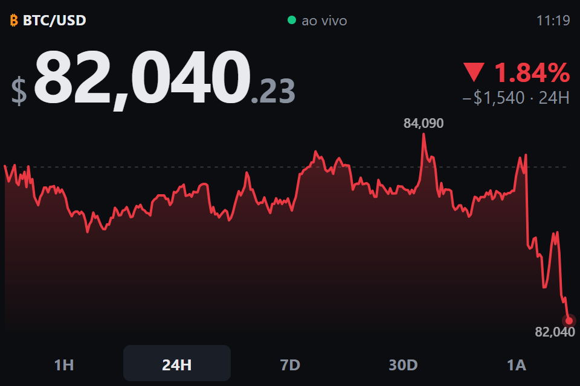

# BTC Widget

**English** | [Português](README.pt-BR.md)

A desk widget that shows the live Bitcoin price and a chart of recent price action, made for a Raspberry Pi 4B with a 3.5" SPI touchscreen (480×320, XPT2046 touch controller).



The build produces **a single file**, `dist/index.html` (~240 KB, with JS and CSS inlined). It opens straight from disk (`file://`), so no web server is needed.

- Live price over the Binance WebSocket (updates about once per second)
- 1H, 24H, 7D, 30D or 1A (1 year) chart, with high, low and a dotted line at the period's opening price
- Change over the selected period, in green or red
- USD or BRL
- Fluid layout that works at any resolution, landscape (480×320) or portrait (320×480)

The on-screen labels are in Portuguese ("ao vivo" means live, "1A" means one year).

## Using the touchscreen

| Tap…                         | Does                          |
| ---------------------------- | ----------------------------- |
| **1H 24H 7D 30D 1A** buttons | changes the chart period      |
| the **price** or **BTC/USD** | switches between USD and BRL  |

Your choices are saved in localStorage and survive restarts.

The indicator at the top shows the connection state: green **ao vivo** (live), amber **conectando/reconectando** (connecting/reconnecting), red **offline**. While it is not live, the price is dimmed and the time of the last update is shown.

## Development

```bash
npm install
npm run dev      # http://localhost:5173 (set DevTools to 480x320 to simulate the screen)
npm run build    # outputs dist/index.html + dist/kiosk.sh
```

### URL parameters (optional)

These set the initial defaults. A tap on the screen takes priority and is saved.

| Parameter   | Values                                                                      | Default |
| ----------- | --------------------------------------------------------------------------- | ------- |
| `currency`  | `USD`, `BRL`                                                                | `USD`   |
| `tf`        | `1H`, `24H`, `7D`, `30D`, `1A`                                              | `24H`   |
| `reload`    | hours between automatic page reloads (`0` turns it off)                     | `12`    |
| `inset`     | extra margin in px: `top,right,bottom,left` (or `20`, `0,20` as in CSS)     | `0`     |
| `calibrate` | `1` shows rulers along the edges to measure the `inset`                     | —       |

Example: `index.html?currency=BRL&tf=7D`

## Installing on the Raspberry Pi

These steps assume the screen already works as the Pi's display (driver or overlay installed and the desktop showing on it).

### 1. Copy the files

From your computer:

```bash
npm run build
scp -r dist/ pi@raspberrypi.local:~/btcwidget
```

On the Pi:

```bash
chmod +x ~/btcwidget/kiosk.sh
~/btcwidget/kiosk.sh          # test it; Alt+F4 closes it
```

`kiosk.sh` opens Chromium full screen. It also suppresses the "Chromium didn't shut down correctly" bar after a power loss and turns off screen blanking on X11.

### 2. Start on boot

This works on Raspberry Pi OS with X11 (LXDE) and on newer releases with Wayland (labwc/wayfire):

```bash
mkdir -p ~/.config/autostart
cat > ~/.config/autostart/btcwidget.desktop <<EOF
[Desktop Entry]
Type=Application
Name=BTC Widget
Exec=$HOME/btcwidget/kiosk.sh
EOF
```

If your system doesn't read `~/.config/autostart`, add the command to the session's own autostart instead:

- **labwc** (recent Bookworm): add the line `~/btcwidget/kiosk.sh &` to `~/.config/labwc/autostart`
- **wayfire**: in `~/.config/wayfire.ini`, under `[autostart]`, add `btc = ~/btcwidget/kiosk.sh`
- **X11/LXDE** (Bullseye and older): add the line `@/home/pi/btcwidget/kiosk.sh` to `~/.config/lxsession/LXDE-pi/autostart`

### 3. Recommended settings

```bash
sudo raspi-config
```

- *System Options → Boot / Auto Login → Desktop Autologin*
- *Display Options → Screen Blanking → No* (keeps the screen on)

The page hides the mouse cursor by itself.

### 4. Screen cutting off the edges

Some panels, or the case around them, hide a few pixels at the edge, which can cut off the clock or the change figures. To measure it:

```bash
~/btcwidget/kiosk.sh "calibrate=1"
```

Rulers from 0 to 60 px appear along each edge. On each side, the smallest number you can see in full is how much the screen hides there. The dashed green line shows the current `inset`; when it is visible on all four sides, the value is right. Tap the screen to close the calibration view.

Then set `DEFAULTS="inset=top,right,bottom,left"` at the top of `kiosk.sh`. The default, `inset=0,20,0,0`, matches the screen this project was built on, which hides about 20 px on the right.

## Running 24/7

- Reconnects on its own with backoff (1 s up to 30 s), and right away when the network comes back
- Watchdog: after 20 s without a message, it drops the connection and opens a new one (this covers sockets that look open but no longer receive data)
- Switches to a secondary Binance host if the primary one fails
- Reloads the chart history every 10 min and after every reconnect, so the chart has no gaps
- Reloads the page every 12 h (it is a local file, so this works even without internet)
- If React throws an error, it shows a message and reloads after 10 s

## Data source

Binance public market data endpoints, no API key required:

- REST: `data-api.binance.vision/api/v3/klines` (fallback `api.binance.com`)
- WebSocket: `data-stream.binance.vision` (fallback `stream.binance.com:9443`), `miniTicker` + `kline` streams

USD uses the `BTCUSDT` pair; BRL uses `BTCBRL`.
